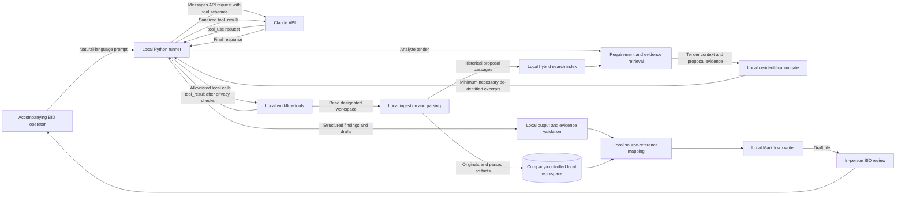

# Proposed Architecture

## Approach

Use a prompt-triggered agent host connected to narrowly scoped local tools. The local tool service handles deterministic workflow steps: workspace selection, parsing, retrieval, de-identification, output validation, source linking, and Markdown writing. Claude performs language-intensive analysis over bounded inputs. BID staff supervise runs in person.

This is preferable to autonomous multi-agent execution for the MVP: the evidence and privacy constraints call for explicit control points, traceability, and inspectable failures. Components can be separated later if scale or ownership boundaries require it.

## Architecture Diagram

## Component Responsibilities

- **Local Python runner:** receives the operator's prompt, calls the Claude Messages API, validates returned `tool_use` blocks, dispatches allowlisted operations, and returns permitted `tool_result` content. It does not give Claude unrestricted shell or filesystem access.
- **Local workflow tools:** expose bounded operations over a designated workspace. Their outputs are visible to Claude and must pass the privacy gate.
- **Local ingestion:** parse documents, preserve structure and source locations, and report incomplete extraction.
- **Source store and index:** retain originals and parsed passages under company access controls; support metadata filters and hybrid lexical/semantic retrieval.
- **Retrieval service:** find relevant proposal passages per requirement and return bounded context with opaque local references.
- **Privacy gate:** minimize content, detect direct and indirect identifiers, replace or generalize them, and fail closed when uncertain.
- **Claude:** analyze de-identified context and return structured results. It is not a source of truth and has no direct access to the raw corpus.
- **Validation and source mapping:** reject unsupported claims or malformed output and resolve citations locally after the response returns.
- **Markdown writer:** creates a draft locally, with source citations resolved against local opaque references.
- **Human review:** accompanying BID staff resolve applicability, conflicts, and gaps; approve material before external use.

## Trust Boundaries

- **Company-controlled:** original tenders and proposals, customer identity, parsed corpus, indexes, identity-token mappings, audit data, and final source mapping.
- **Claude request and tool responses:** only minimum necessary excerpts that passed local de-identification. Customer-identifying information is prohibited. Tool responses are visible to Claude and must be treated as outbound data.
- **Prototype operator:** no custom UI or formal application authentication. Run only on a company-controlled machine and designated workspace, with OS-level access controls; do not expose local tools on an untrusted network.
- **MCP:** not required for direct Claude API tool use. It may be reconsidered if a future host or external system specifically benefits from MCP.

## Failure Behavior

- Parsing failure or low confidence: disclose it and require correction or review; never silently imply complete coverage.
- Privacy uncertainty: block the request.
- No relevant proposal evidence: report a gap.
- Conflicting claims: show the evidence and request human resolution.
- Invalid or unsupported Claude output: reject it or return it for correction; do not present it as an established capability.

## Trade-offs

Local parsing and indexing reduce outbound data but create internal operational responsibilities. Prompt-triggered MCP tools are convenient for accompanied operation but add a host/runtime dependency and must be narrowly scoped. A staged workflow is less autonomous than multi-agent execution but easier to audit. De-identification enables Claude use but requires ongoing testing and a fail-closed path. Hybrid retrieval improves discovery but does not replace evidence review.